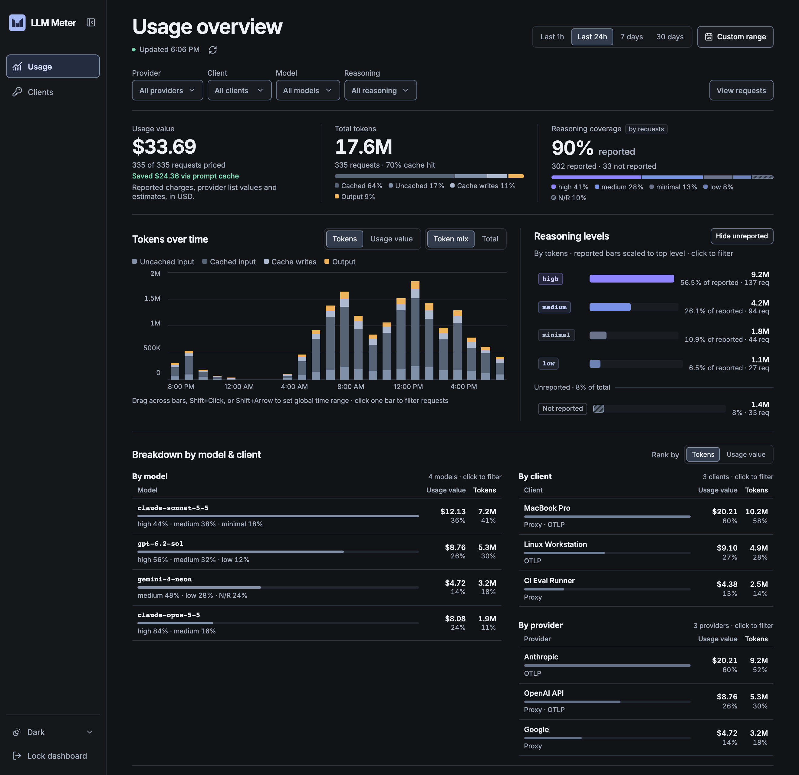
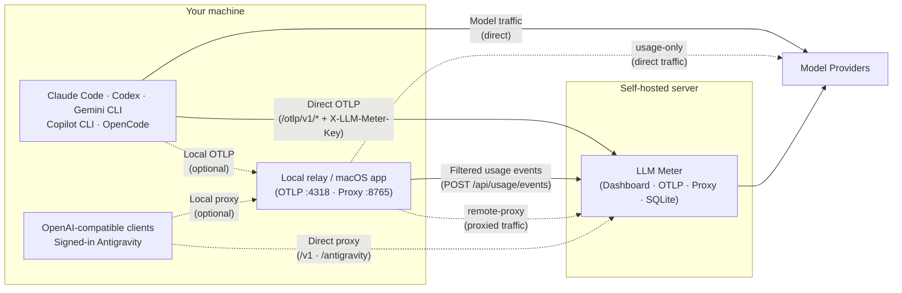

# LLM Meter

LLM Meter is a self-hosted dashboard for tracking LLM token usage, reasoning levels, and estimated spend across your AI tools. Collect usage from Claude Code, Codex, Gemini CLI, GitHub Copilot CLI, and OpenCode via OpenTelemetry, or meter generic OpenAI-compatible clients and signed-in Antigravity through the HTTP proxy.

[Website](https://mishankov.github.io/llm-meter/) · [Configuration Guide](docs/configuration.md) · [macOS Menu Bar Relay](desktop/README.md) · [Releases](https://github.com/mishankov/llm-meter/releases)

> **Alpha release:** LLM Meter is in early public alpha. Back up your SQLite database (`llm-meter.db`) before upgrading; configuration options and API details may still evolve.

<picture>
  <source media="(prefers-color-scheme: dark)" srcset="docs/assets/dashboard-dark.png">
  <source media="(prefers-color-scheme: light)" srcset="docs/assets/dashboard-light.png">
  
</picture>

## Features

- **Usage & spend analytics:** Track token mix (uncached input, cached input, cache writes, output), prompt cache savings, estimated USD spend, and reasoning-level coverage over preset or custom time ranges, with breakdowns by model, client, and provider plus per-request drill-down.
- **Privacy-first metering:** OpenTelemetry and `usage-only` relay modes keep prompts, responses, and provider credentials on your machine. The OpenTelemetry receiver strips content fields, and the proxy validates and removes `X-LLM-Meter-Key` before forwarding upstream.
- **Automatic pricing catalogs:** Preserves provider-reported amounts (including `$0`) and syncs Models.dev and OpenCode Go catalogs daily in SQLite, backed by built-in OpenAI rates and custom per-model overrides via `PRICING_FILE`.
- **Lightweight self-hosting:** One Go binary serves the embedded dashboard, proxy endpoints, and usage ingestion API backed by SQLite—no external database required. Includes multi-arch Docker images (`linux/amd64`, `linux/arm64`) and a native [macOS menu bar relay app](desktop/README.md).
- **Accessible UI:** Light, dark, and system themes, collapsible sidebar, and full keyboard navigation.

## Quickstart

### 1. Start the server

```sh
export DASHBOARD_TOKEN="$(openssl rand -hex 32)"
echo "Dashboard token: $DASHBOARD_TOKEN"

docker run --rm -p 127.0.0.1:8080:8080 \
  -e DASHBOARD_TOKEN -e COOKIE_SECURE=false \
  -v llm-meter-data:/data \
  ghcr.io/mishankov/llm-meter:latest
```

Open `http://localhost:8080`, unlock with `DASHBOARD_TOKEN`, then open **Clients** to create a client and copy its key (`llmm_...`).

For production behind HTTPS, leave `COOKIE_SECURE=true` (the default) and see [Docker Compose behind HTTPS](docs/configuration.md#docker-compose-behind-https).

### 2. Connect your tools

- **Direct to server (no relay needed):**
  - **Coding CLIs (OpenTelemetry):** Point the CLI's OTLP exporter at `http://localhost:8080/otlp` (or `https://proxy.example.com/otlp`) and send your client key in `X-LLM-Meter-Key`.
  - **OpenAI-compatible clients:** Set the base URL to `http://localhost:8080/v1` (or `https://proxy.example.com/v1`) and pass `X-LLM-Meter-Key` alongside your usual `Authorization` header.
- **Via local relay (optional):** Run the [macOS menu bar app](desktop/README.md) or the Docker / Go relay ([relay setup](docs/configuration.md#4-run-the-local-relay)) for a single place to manage your client key across all tools, local telemetry filtering, offline SQLite queueing, and clients that cannot set custom headers (such as Antigravity ACP). The relay connects to your server over HTTPS (`--target https://...`).

## Supported clients

| Client | Metering method | Direct server URL (`X-LLM-Meter-Key`) | Via local relay | Setup guide |
| --- | --- | --- | --- | --- |
| **Claude Code** | OpenTelemetry (logs) | `<server>/otlp/v1/logs` | `http://127.0.0.1:4318/otlp/v1/logs` | [Claude Code setup](docs/configuration.md#claude-code) |
| **Codex** | OpenTelemetry (logs) | `<server>/otlp/v1/logs` | `http://127.0.0.1:4318/otlp/v1/logs` | [Codex setup](docs/configuration.md#codex) |
| **Gemini CLI** | OpenTelemetry (logs) | `<server>/otlp` | `http://127.0.0.1:4318/otlp` | [Gemini CLI setup](docs/configuration.md#gemini-cli) |
| **GitHub Copilot CLI** | OpenTelemetry (traces) | `https://<server>/otlp` | `https://127.0.0.1:4318/otlp` | [Copilot CLI setup](docs/configuration.md#github-copilot-cli) |
| **OpenCode** | OpenTelemetry (traces) | `<server>/otlp` | `http://127.0.0.1:4318/otlp` | [OpenCode setup](docs/configuration.md#opencode) |
| **OpenAI-compatible SDKs / CLIs** | HTTP proxy | `<server>/v1` | `http://127.0.0.1:8765/v1` | [OpenAI-compatible setup](docs/configuration.md#51-generic-openai-compatible-clients) |
| **Signed-in Antigravity** | HTTP proxy | `<server>/antigravity` | `http://127.0.0.1:8765/antigravity` | [Antigravity setup](docs/configuration.md#52-signed-in-antigravity) |

## How it works

You can connect tools **directly to the LLM Meter server** or through an optional **local relay**:

- **Direct to server:** Coding CLIs export OTLP straight to `/otlp/v1/{logs,traces,metrics}` using `X-LLM-Meter-Key` while keeping model traffic direct to their providers—handy for local deployments or single-CLI setups. OpenAI-compatible and Antigravity clients that support custom headers can also proxy directly through `/v1` or `/antigravity`.
- **Via local relay (CLI or macOS menu bar app):** Gives you a single point of authentication for all local tools (store and rotate one key in Keychain or `proxy.key`), strips prompts and non-usage telemetry fields on your machine before anything leaves localhost, queues usage in SQLite across network outages, and supports endpoint-only proxy clients in `usage-only` (direct to provider) or `remote-proxy` (via server) mode.



| Path | Best for | Model traffic | Server sees |
| --- | --- | --- | --- |
| **Direct OpenTelemetry (`/otlp`)** | Local deployments or simple setups with no extra relay process | Client → Provider directly | Full exported telemetry (only extracted usage metadata is stored) |
| **OpenTelemetry via relay** | Single key across multiple CLIs, local content stripping, offline queueing | Client → Provider directly | Filtered usage metadata only (`POST /api/usage/events`) |
| **Local relay (`usage-only`)** | OpenAI-compatible clients & Antigravity that cannot send custom headers | Client → Relay → Provider directly | Usage metadata only; queued locally in SQLite with retries |
| **Local relay (`remote-proxy`)** | Routing endpoint-only clients through the central server | Client → Relay → LLM Meter → Provider | Full proxied requests & upstream auth headers |
| **Direct proxy (`/v1`, `/antigravity`)** | OpenAI-compatible SDKs/CLIs or Antigravity supporting custom headers | Client → LLM Meter → Provider | Full proxied requests & upstream auth headers |

For deployment topologies, security hardening, durable queue semantics, upgrades, key rotation, and troubleshooting, see the [Configuration Guide](docs/configuration.md).

## Pricing and configuration

LLM Meter resolves cost in USD in this order:

1. **Provider-reported amounts** (including `$0`).
2. **`PRICING_FILE` overrides** (`provider/model`, then `model`), in USD per million tokens.
3. **Downloaded catalogs** from Models.dev and OpenCode Go, refreshed at startup and every 24 hours and cached in SQLite so outages do not lose rates.
4. **Built-in OpenAI rates** (including long-context, service-tier, and background completion adjustments).

Requests without complete rate data are shown as **Unpriced**. Example `PRICING_FILE`:

```json
{
  "my-model": { "input": 2, "cachedInput": 0.1, "output": 10, "cacheWrite": 2.5, "cacheWrite12h": 5 }
}
```

### Server environment variables

| Variable | Default | Notes |
| --- | --- | --- |
| `DASHBOARD_TOKEN` | _(required)_ | 24–512 characters; unlocks the dashboard and signs session cookies. |
| `COOKIE_SECURE` | `true` | Keep `true` behind HTTPS; set `false` only for local HTTP. |
| `LISTEN_ADDR` | `:8080` | Server TCP listen address. |
| `DATA_DIR` | `./data` (`/data` in Docker) | Directory for `llm-meter.db`. |
| `PRICING_FILE` | _(unset)_ | Optional JSON file of per-model rate overrides (USD / 1M tokens). |
| `OPENAI_UPSTREAM` | `https://api.openai.com/v1` | Optional base URL override for `/v1` proxy traffic. |
| `ANTIGRAVITY_UPSTREAM` | `https://daily-cloudcode-pa.googleapis.com` | Optional base URL override for `/antigravity` proxy traffic. |
| `DASHBOARD_DIR` | `web/build` | Static UI path when built without `-tags embedui`. |

See the [Configuration Guide](docs/configuration.md#server-environment-variables) for upstream provider detection, relay flags, Docker Compose templates, and troubleshooting.

## Development

### Server and web dashboard

Requires **Go 1.25+** and **Node.js 24**. The static SvelteKit frontend builds into `web/build` and is embedded into the release/Docker binary with `-tags embedui`.

```sh
npm ci --prefix web
npm run check --prefix web
npm run build --prefix web
go test -race ./...
go vet ./...

export DASHBOARD_TOKEN="$(openssl rand -hex 32)"
COOKIE_SECURE=false LISTEN_ADDR=127.0.0.1:8080 go run .
```

Build a self-contained binary with embedded UI:

```sh
CGO_ENABLED=0 go build -tags embedui -o llm-meter .
```

Run the Playwright keyboard and interaction tests:

```sh
npm exec --prefix web -- playwright install chromium
npm test --prefix web
```

### macOS menu bar relay

Requires macOS, Xcode Command Line Tools, **Go 1.26+**, **Node.js 24**, and Wails v3. See [desktop/README.md](desktop/README.md) for build, packaging, and test instructions.

## License

MIT — see [LICENSE](LICENSE).
